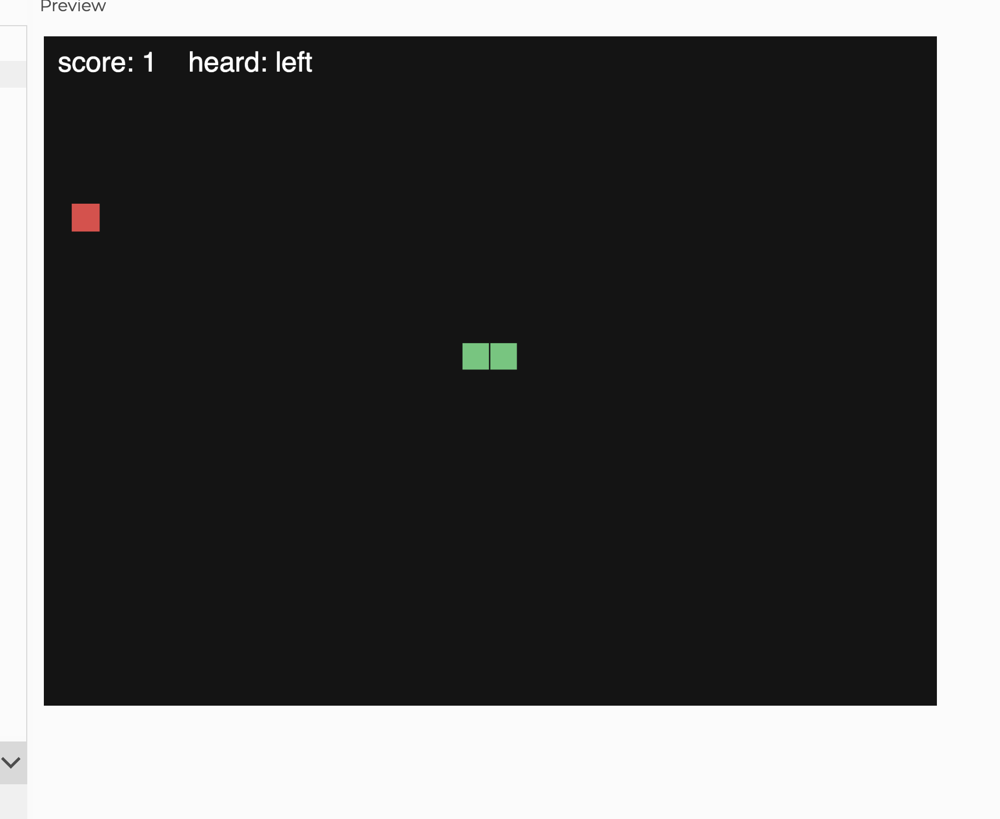
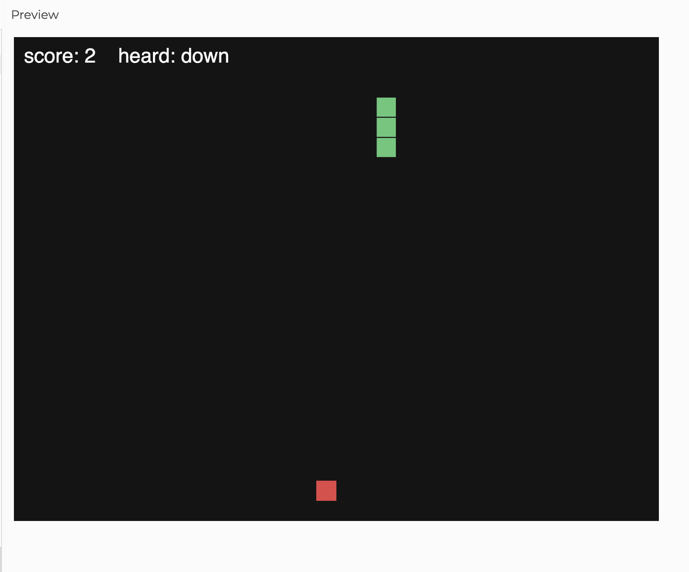
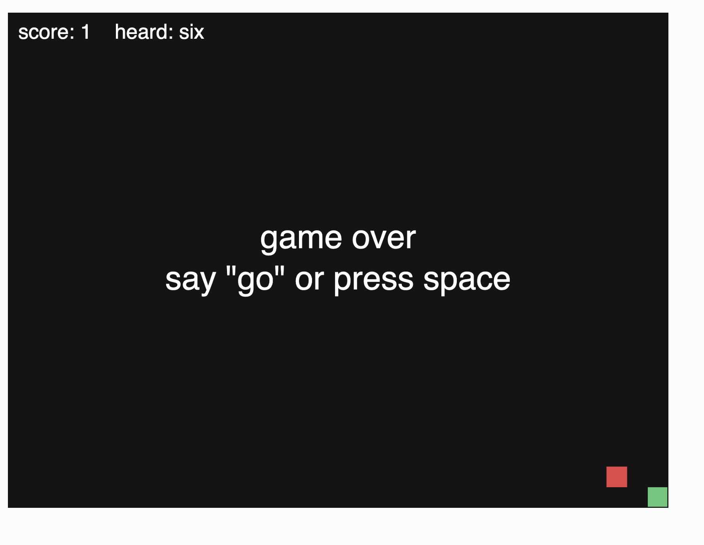

# Voice Snake

https://editor.p5js.org/Escape_yuki/full/UIjQglI4u

A classic snake game you control with your voice. The snake starts as one block. Every time it eats the red apple, it grows one block longer. If it hits a wall or its own body, the game is over.

## How it works

- Voice: ml5's `soundClassifier` uses the pretrained `SpeechCommands18w` model to listen to the microphone. Saying "up", "down", "left", or "right" turns the snake, and "go" restarts after a game over. `probabilityThreshold` is 0.7, so it only reacts when the model is fairly confident.
- Keyboard: the arrow keys also turn the snake and space restarts, so I can test it without talking.
- Grid: the 640x480 canvas is split into 20px cells (32 x 24). The snake is a list of cells, with the head first.
- Moving: every 20 frames, a new head is added in front of the snake and the last tail block is removed, so the snake slides forward one cell. It moves slowly on purpose because the model takes a moment to recognize each word.
- Eating: if the new head lands on the apple, the tail is not removed that step, so the snake grows by one. A new apple is placed on a random cell that isn't part of the snake.
- No U-turns: the snake can't turn straight back into itself. The turn is checked against the direction of the last step, so two quick key presses can't sneak a U-turn in.
- Game over: hitting a wall or any part of the body ends the game.
- Score: shown in the top left next to the last word the model heard. The score is the snake's length minus one.

<!-- TODO: add screenshots to Images/ with these names -->

## Reflection

<!-- DRAFT: rewrite in your own words -->

The model is kinda slow. It listens to about one second of audio at a time, so it can't tell which word I said until I've finished saying it. By the time it hears "left", the snake has already moved a few cells past where I wanted to turn. Sometimes it also hears the wrong word, or nothing at all, and I have to say it again.

That makes the game really hard to beat. Apples near the walls are risky, and once the snake gets longer I usually crash into my own body before the model catches my turn. I slowed the snake down to one step every 20 frames, which helps a little, but then the game feels slow. With the arrow keys it's easy, so the hard part is the voice control, not the game.

Next time I would change the game to fit the model. The walls could wrap around so hitting one doesn't end the game, or the snake could only move when it hears a word. I learned that a model can understand the words and still be too slow for a fast game, so timing matters as much as accuracy.
