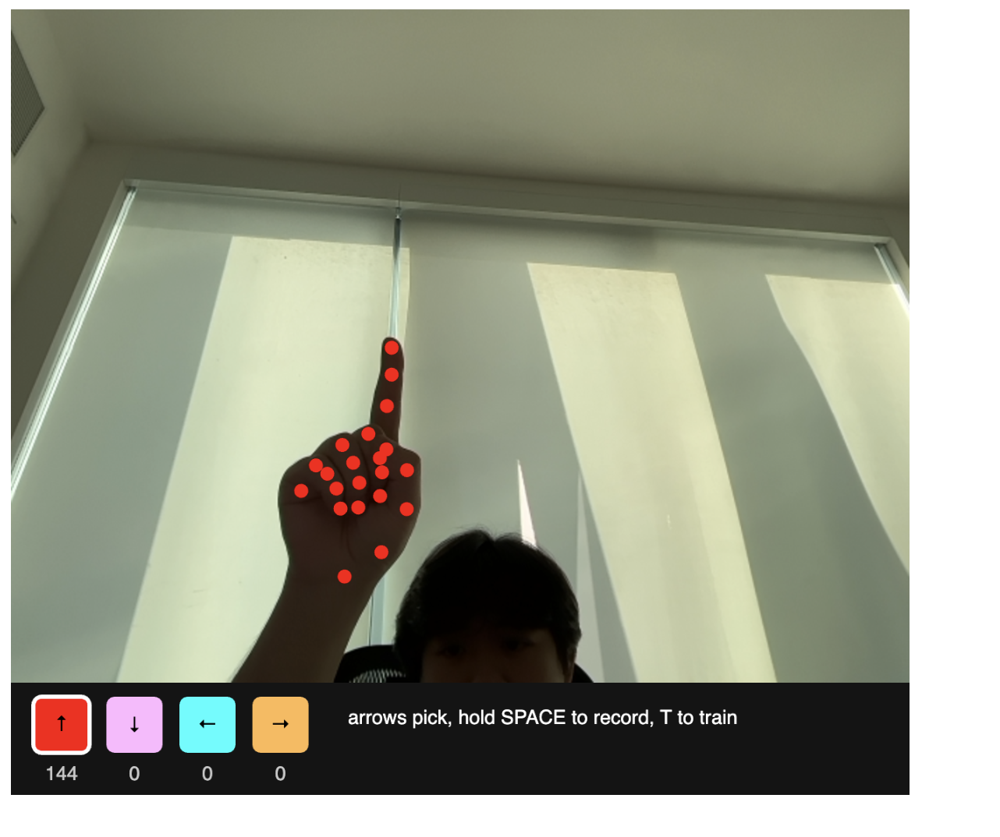
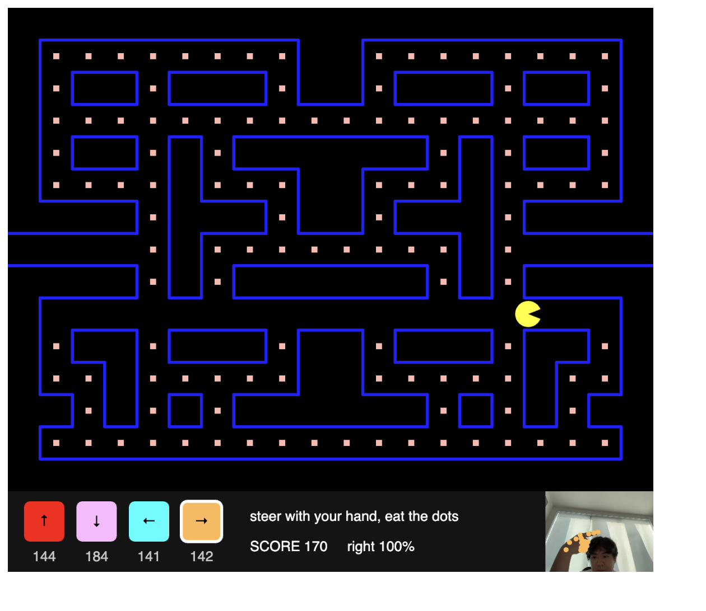
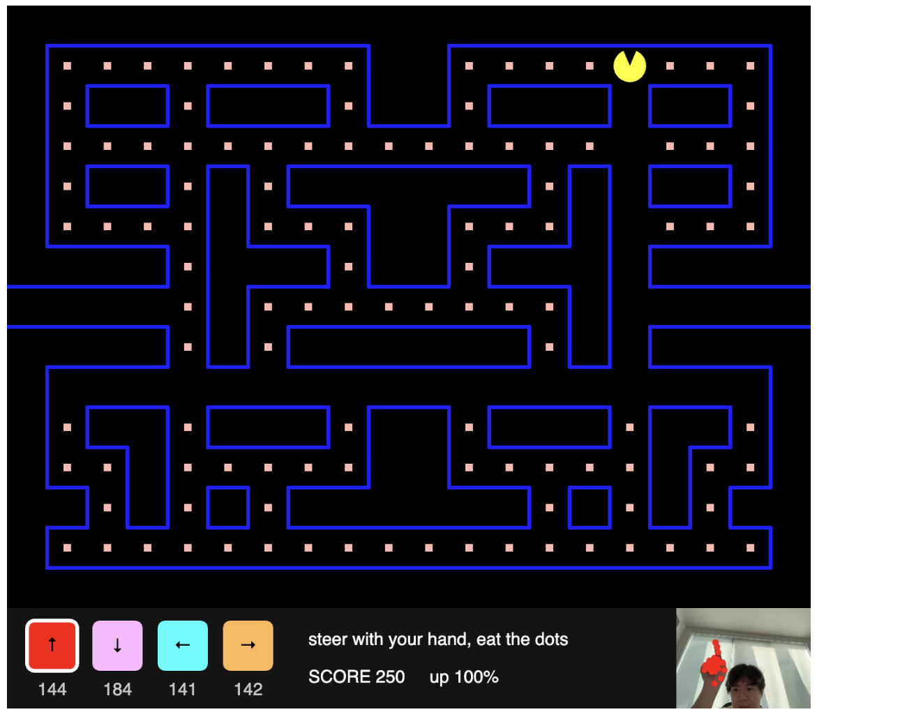

# Hand Pac-Man

https://editor.p5js.org/Escape_yuki/full/F0NcZrgUN

You teach a neural network four hand poses, one for each direction: up, down, left, and right. Then your hand steers Pac-Man through a maze. Pac-Man eats the dots in the tunnels, and the tunnel in the middle row takes him from one side of the screen to the other.

## How it works

- Hand tracking: ml5's `handPose` finds 21 keypoints on one hand from the webcam.
- Inputs: all 21 keypoints (42 numbers). Each point is measured from the wrist and divided by the hand's size (wrist to the base of the middle finger). That way the guess depends on the shape of the hand, not on where the hand is or how close it is to the camera. The points are not rotated, so a hand pointing up and a hand pointing left give different numbers.
- Outputs: one of 4 labels, "up", "down", "left", or "right". This is a classification model (`task: "classification"`). ml5 gives a confidence for every label, with the most confident one first, and the sketch uses that one.
- Collecting data: press an arrow key to pick a direction, then hold SPACE while posing your hand. Every time handPose finds the hand, one example is added. The number under each swatch counts how many examples that direction has.
- Training: press T. It needs examples for all 4 directions, because Pac-Man needs all four to get around the maze. It trains for 50 epochs with batch size 10 and shows the epoch and loss at the bottom. `debug: true` also opens ml5's loss graph.
- Playing: after training, every new hand detection is sent to `classify`, and the answer becomes the direction Pac-Man wants to go. The swatch for that direction gets a white outline, and the bottom shows the score and the confidence. A small camera view in the corner shows your hand while you play.
- Mirror: like Assignment 5, I flip the camera myself with `translate` and `scale(-1, 1)`.

## The game

- The maze: a list of 20 text rows, 15 rows tall, with 32 pixel tiles. `#` is a wall, `.` is a dot, a space is an empty path, and `P` is where Pac-Man starts. To change the maze, I just change the text.
- Moving: Pac-Man keeps going until he hits a wall. He moves 2 pixels every frame. He only turns in the middle of a tile so he stays in the lanes. If the hand asks for a turn early, the turn waits until there is an opening. Turning around works anytime, like in the arcade.
- The tunnel: row 7 has no wall at the ends. When Pac-Man goes off one side, he comes back on the other. He is drawn on both sides of the screen while he crosses, so he slides through instead of jumping.
- Dots: each dot is worth 10 points. When all 139 are eaten, the message says "you cleared the tunnel!".

## Pac-Man style

I looked up the original arcade game ([The Pac-Man Dossier](https://pacman.holenet.info/), [Wikipedia](https://en.wikipedia.org/wiki/Pac-Man)) and copied its look:

- Pac-Man is a yellow circle with a wedge for a mouth. The designer, Toru Iwatani, was partly inspired by a pizza with a slice missing. The name comes from "paku paku", the Japanese sound for a mouth opening and closing, so the mouth chomps while he moves and stays half open when he stops.
- The maze is thin blue lines on a black background, and the dots are small peach squares.
- The arcade has tunnels on the sides that wrap around to the other side of the screen.
- The four direction swatches use the ghost colors: Blinky is red, Pinky is pink, Inky is cyan, and Clyde is orange.

<!-- TODO: add screenshots to Images/ with these names -->

## From regression to classification

This started as my Hand Colors sketch, which used regression. Regression predicts numbers, so a hand between two poses could get a color between two colors. That doesn't work for directions. Pac-Man can't go halfway between up and left, so the network has to pick one of the four. That's why this version uses classification.

I also took out `learningRate: 0.02`. I only lowered it in Hand Colors so the in-between poses would blend. Here a sharp edge between the poses is what I want, so the sketch uses ml5's default. I tested it with fake hand data for the four directions, and it guessed each one right with about 95% confidence.

<!-- TODO: add how well it classified your real hand poses -->

## Reflection

<!-- DRAFT: rewrite in your own words, and add what happened when you tried it with your real webcam -->

Turning Hand Colors into a game changed what I needed from the network. In Hand Colors, the in-between hands were the fun part. In the game, an in-between hand is a problem, because it can make the network guess the wrong direction. Most of the new code is not about machine learning. It's about moving Pac-Man through the grid: staying in the lanes, saving a turn until there is an opening, and wrapping through the tunnel.

<!-- TODO: how did it feel to steer with your real hand? Which poses were easy to tell apart? Did Pac-Man ever turn the wrong way? -->

Next time I would like to only turn Pac-Man when the network is confident, so a half-made pose doesn't send him the wrong way. I would also like to add the ghosts and the power pellets, so there is something to run from.
