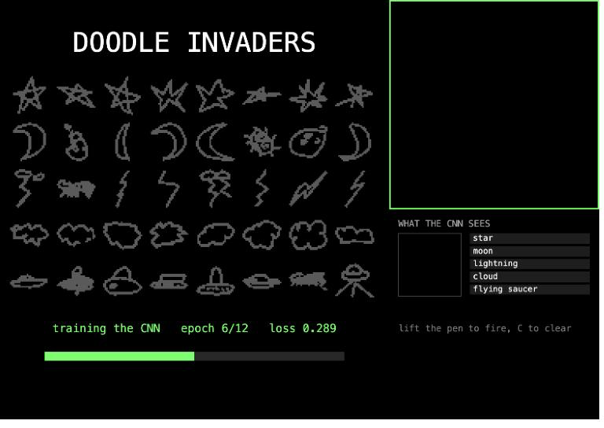
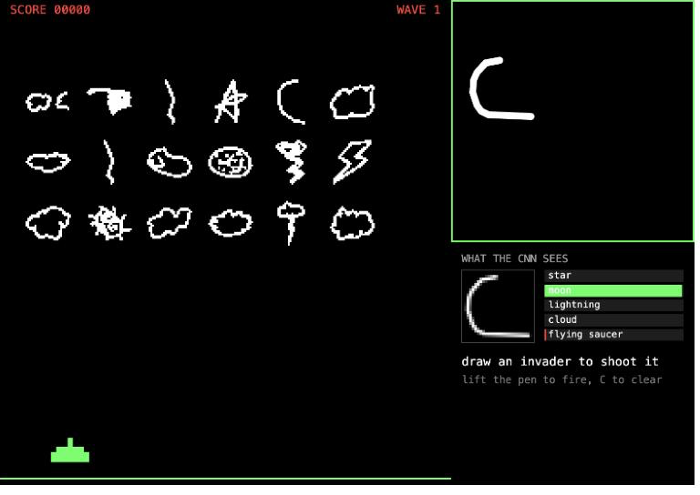
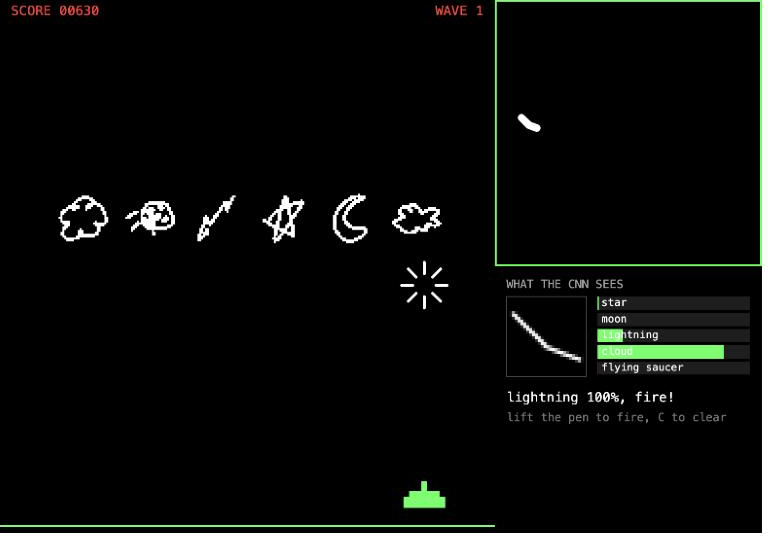
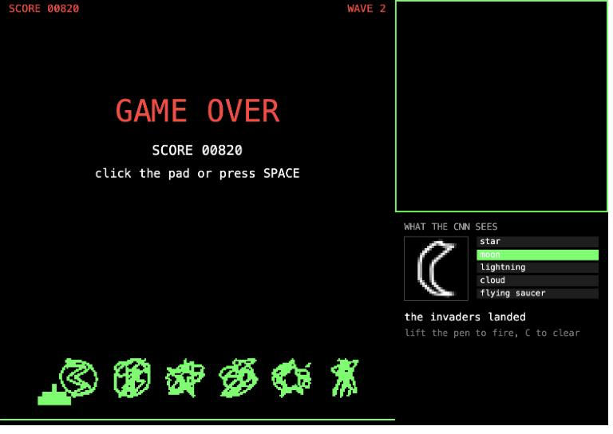

# Doodle Invaders

<!-- TODO: paste your p5 editor link here -->

A Space Invaders game you play by drawing. Stars, moons, lightning bolts, and clouds march down the screen, and every one of them is a real doodle from Google's [Quick, Draw! dataset](https://github.com/googlecreativelab/quickdraw-dataset). To shoot one, you draw the same thing on the pad. A convolutional neural network that trains in the browser decides what you drew, and the cannon fires at the lowest invader of that kind.

I built this on [Training a Doodle Classifier with Convolutional Layers](https://editor.p5js.org/jackbdu/sketches/Id2cg4UQL).

## Reading

[An Intuitive Explanation of Convolutional Neural Networks](https://ujjwalkarn.me/2016/08/11/intuitive-explanation-convnets/) by Ujjwal Karn splits a CNN into four operations. I can point to each one in my sketch:

- Convolution: a small filter slides over the image and makes a feature map, which shows where that pattern is. My first layer has 16 filters, each 3x3.
- Non-linearity: `activation: "relu"` comes after each convolution, so the network can learn things that aren't straight lines.
- Pooling: `maxPooling2d` keeps the biggest value in each 2x2 block. The picture gets smaller, and small shifts in the drawing matter less.
- Classification: `flatten` and the last `dense` layer turn the features into 5 probabilities that add up to 1.

The sizes in my network go 28x28, 26x26, 13x13, 11x11, 5x5, then 800 numbers, then 5 outputs.

## How it works

- Data: 1,100 doodles each for star, moon, lightning, cloud, and flying saucer. Each one is 784 bytes (28x28 grayscale). Google's files are around 100 MB each, so I only downloaded the first 1,100 doodles of each one, which makes `.bin` files like the `cats1000.bin` in the example.
- Training and test data: 1,000 doodles per label train the network. The other 100 per label are never shown to it. Those are the test, and they are also the invaders, so you always fight doodles the network has never seen.
- Layers: the example's commented-out `customLayers`, changed to 16 and 32 filters with 3x3 kernels. There are 8,805 weights.
- Training: `task: "imageClassification"`, 12 epochs, and `learningRate: 0.1`, which I took from the handwritten digit example. It takes about 16 seconds on my laptop. The training screen shows the epoch and loss. I turned `debug` off because ml5's graph would cover the drawing pad.
- Testing: after training, the sketch quizzes the network on the 500 hidden doodles and shows the score on the title screen. It usually says 87% or 88%.
- Drawing: the pad saves your strokes as lists of points. Then it redraws them at 28x28, the same way the dataset was made (see below). "What the CNN sees" shows that small picture.
- Guessing: while you draw, the sketch keeps sending the picture to `classify`, and the 5 bars show the answer live. They change as the drawing grows.
- Firing: lifting the pen for 0.4 seconds finishes the doodle, so you have time to add another stroke. If the top guess is at least 50% sure, the cannon shoots the lowest invader of that kind. If there isn't one, the message says "none up there".

## The game

- The invaders: 3 rows of 6, 18 in total. Each kind is picked at random. Each invader has two different doodles of the same thing and flips between them as it marches, so the lines wiggle.
- Marching: the whole group steps sideways, and when one invader touches the edge, they all drop 16 pixels and turn around. If nobody draws anything, they land in a little under 2 minutes.
- Score: 10, 20, and 30 points from the bottom row to the top.
- The mystery ship: a flying saucer doodle crosses the top. It's worth 50, 100, 150, or 300 points, but you have to draw a flying saucer before it leaves, which takes longer than a star.
- Waves: clearing the invaders starts a new wave. It starts lower and moves faster.
- Keys: C clears the pad. SPACE or a click on the pad starts the game.

## Space Invaders style

I looked up the original 1978 game on [Wikipedia](https://en.wikipedia.org/wiki/Space_Invaders) and copied what I could:

- The invaders start as 5 rows of 11. I only have 18 because drawing is much slower than pressing a button.
- They speed up as you defeat them. In the arcade this started as an accident. The processor could draw fewer aliens faster, and the designer, Tomohiro Nishikado, liked it and kept it. In my sketch the wait between steps shrinks on purpose.
- The first cabinets were black and white, with strips of orange and green cellophane on the screen. I draw everything in white and then lay red and green rectangles over it with `blendMode(MULTIPLY)`. It works the same way, so invaders turn green when they cross into the bottom strip.
- Each new wave starts lower.
- A mystery ship crosses the top for bonus points. Mine is a doodle from the dataset, so that's the only reason the fifth label exists.

## Reading the four examples

- [Doodle classifier](https://editor.p5js.org/jackbdu/sketches/Id2cg4UQL), the one I built on: `prepareData` cuts one long list of bytes into 784-pixel images. `classify` flips the pixels with `1 - value / 255`, because the canvas is black on white and the dataset is white on black.
- [Handwritten digits](https://editor.p5js.org/jackbdu/sketches/ab7lfmRyH): the same idea with MNIST, but those files start with a header, so the images start at byte 16 and the labels at byte 8. The labels are in a second file.
- [Webcam](https://editor.p5js.org/jackbdu/sketches/7Y6VDvUO6): you make the dataset yourself with buttons. The pictures have 4 channels (RGBA), and the batch size is only 4 because there aren't many examples.
- [DoodleNet](https://editor.p5js.org/jackbdu/sketches/ts3fuRZGW): no training at all. It's a pretrained model and `classifyStart` runs the loop for you. It's much shorter, but you can't choose its labels, and I needed exactly these five.

## What I found

### Where you draw matters more than the layers

The example resizes the whole canvas to 28x28. But the dataset's doodles are all centered, and they all fill the frame the same way (the ink is always 26 pixels on its longest side). So I find the box around your strokes, scale the longest side to 23 pixels, center it, and draw it with a 1.5 pixel line. With those numbers, my pictures measure the same as the dataset: 26 pixels wide, and 14.5% ink compared to 14.6%.

To test this, I took 1,000 real recognized drawings from the dataset as pen strokes (from much further into the files than the training doodles), and put them on the pad at random sizes and positions:

| How the picture is made | Accuracy |
| --- | --- |
| The example: resize the whole canvas | 53.7% |
| Mine: redraw the strokes centered | 89.7% |

The network is the same in both rows. Pooling only helps with small shifts, and a doodle in the corner of the pad is not a small shift.

### Comparing layers

Each row is the average of 3 runs on the 500 hidden doodles.

| Network | Weights | Test accuracy | Training |
| --- | --- | --- | --- |
| No convolution: flatten, dense 64, softmax | 50,565 | 79.1% | 6 s |
| The example's default CNN: 8 and 16 filters, 5x5 | 4,709 | 86.2% | 25 s |
| Mine: 16 and 32 filters, 3x3, learning rate 0.1, 24 epochs | 8,805 | 88.5% | 30 s |
| Mine with 12 epochs (the final sketch) | 8,805 | 87.9% | 16 s |

The first two use ml5's default learning rate of 0.02. The network with no convolution has almost 6 times the weights of my CNN and still does worse, because a filter uses the same few weights all over the picture. I went with 12 epochs because 24 only added about half a percent and doubled the wait. At 24 epochs, it got 99% on the training data but stayed at 88.5% on the test, so the extra time mostly went to memorizing.

### The validation set was only one label

ml5 doesn't mix the data, and TensorFlow.js takes the validation set from the end of the list before it shuffles anything. The doodle example adds one label at a time, so its validation set is only trains. When I tested this without mixing, the last 500 doodles were all flying saucers, and validation said 75.8% while the real test accuracy was 86.4%. So `shuffle(allData, true)` runs before `addData`.

### A tap shot an invader

When I clicked the pad without drawing, the network said "moon 59%" and the cannon fired. Softmax always adds up to 100%, so the network has no way to say "that's nothing". Now a doodle has to be at least 20 pixels on the pad to count.

### Two things that only matter on the p5 web editor

- It only finds uploaded files if the whole path is one string, so the five `loadBytes` lines are written out instead of being built in a loop.
- It stops any plain `for` loop that runs longer than 100 ms. `prepareData` takes about 40 ms on my laptop, but it spiked to 340 ms once, so `index.html` starts with `<!-- noprotect -->`, which turns that check off.

## Reflection

<!-- DRAFT: rewrite in your own words, and add what happened when you played it with your real mouse or trackpad -->

The biggest jump came from before the network, not from the layers. Convolution took the test score from 79% to 86%. Centering the doodle took real drawings from 54% to 90%. The network only knows what its dataset looks like, so getting my drawing to look like that data mattered more than making the network better.

I also learned that confidence is not the same as being right. On the 1,000 drawings, the network was wrong 103 times, and 37 of those times it was more than 80% sure. My 50% check only stopped 19 of them. I saw the same thing in the game, where it called a flying saucer "cloud 98%". So the 50% check doesn't stop most mistakes.

Like Voice Snake, the game had to fit the model. Doodles are slower than button presses, so there are fewer invaders, and the pause after lifting the pen is there so a drawing with a few strokes isn't read too early. A half-finished moon can look like something else, and you can watch the bars change their mind while you draw.

<!-- TODO: how did it feel to draw with your real mouse? Which shapes did it read best and worst? Did the invaders ever land? -->

Next time I would add a "nothing" label trained on random scribbles, so the network can say no. I would also shift and rotate the training doodles so it depends less on my centering step, and show the feature maps from the first layer, so you can see what the filters actually find.
